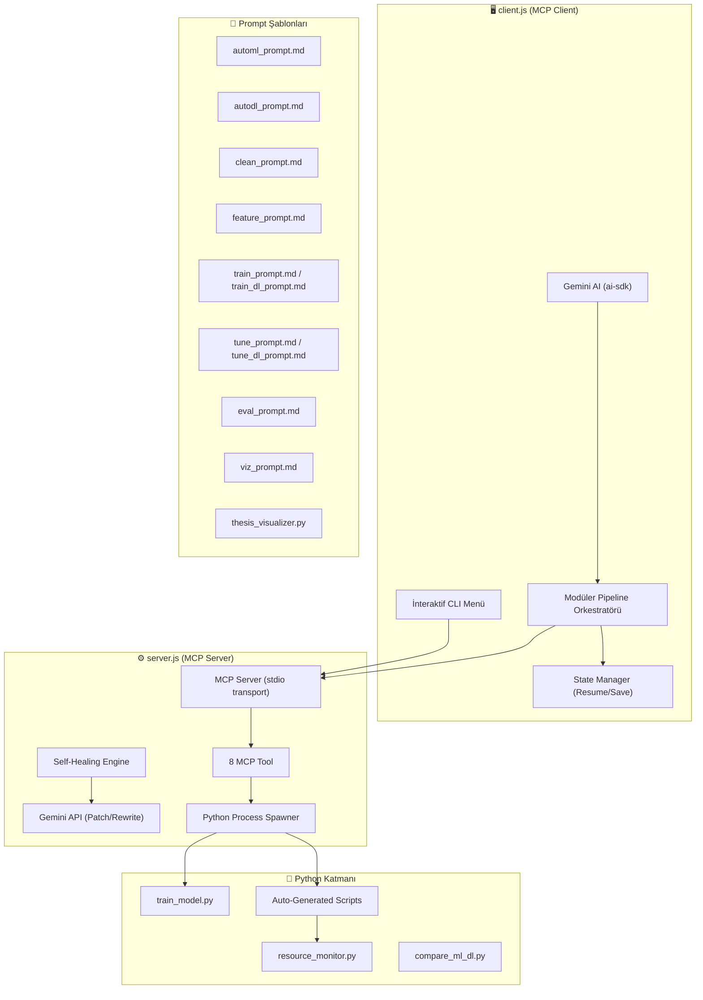
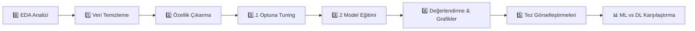

# 🔍 Phishing MCP Server — Proje Analizi

## 🎯 Projenin Amacı

Bu proje, **tez çalışması** kapsamında geliştirilmiş bir **AI-Agent Orchestrated Phishing Detection** (Yapay Zeka Aracı ile Yönetilen Oltalama Saldırısı Tespiti) sistemidir. 

**Model Context Protocol (MCP)** kullanarak bir Node.js sunucu ve istemci mimarisi oluşturulmuş; Gemini AI (LLM) ile otonom olarak ML/DL modelleri oluşturan, eğiten, değerlendiren ve görselleştiren bir **tam otomatik pipeline** inşa edilmiştir.

---

## 🏗️ Mimari Genel Bakış

---

## 📂 Dosya Yapısı ve Bileşenler

### Çekirdek Dosyalar

| Dosya | Boyut | Açıklama |
|-------|-------|----------|
| [server.js](file:///c:/TU/deu/tez_v2/scraped%20data/phishing_mcp_server/server.js) | 27 KB | MCP sunucu, 8 tool tanımı, self-healing engine, Python process spawner |
| [client.js](file:///c:/TU/deu/tez_v2/scraped%20data/phishing_mcp_server/client.js) | 38 KB | İnteraktif CLI, modüler pipeline orkestratörü, state management, Gemini entegrasyonu |
| [train_model.py](file:///c:/TU/deu/tez_v2/scraped%20data/phishing_mcp_server/train_model.py) | 2.6 KB | Manuel ML eğitim scripti (Logistic / Naive Bayes) |
| [resource_monitor.py](file:///c:/TU/deu/tez_v2/scraped%20data/phishing_mcp_server/resource_monitor.py) | 1.7 KB | CPU ve RAM kaynak izleme sınıfı (psutil) |
| [compare_ml_dl.py](file:///c:/TU/deu/tez_v2/scraped%20data/phishing_mcp_server/compare_ml_dl.py) | 8.5 KB | ML vs DL nihai karşılaştırma grafik üreticisi |
| [package.json](file:///c:/TU/deu/tez_v2/scraped%20data/phishing_mcp_server/package.json) | 613 B | Node.js proje yapılandırması (ESM modül) |
| [.env](file:///c:/TU/deu/tez_v2/scraped%20data/phishing_mcp_server/.env) | 135 B | Gemini API Key + Python yolu |

### Prompt Şablonları (11 dosya)

| Dosya | Amaç |
|-------|------|
| [automl_prompt.md](file:///c:/TU/deu/tez_v2/scraped%20data/phishing_mcp_server/prompts/automl_prompt.md) | Tek seferde AutoML script üreten prompt (6 classifier + Optuna + Hybrid) |
| [autodl_prompt.md](file:///c:/TU/deu/tez_v2/scraped%20data/phishing_mcp_server/prompts/autodl_prompt.md) | Tek seferde AutoDL script üreten prompt |
| [clean_prompt.md](file:///c:/TU/deu/tez_v2/scraped%20data/phishing_mcp_server/prompts/clean_prompt.md) | Veri temizleme kodu üretim promptu |
| [feature_prompt.md](file:///c:/TU/deu/tez_v2/scraped%20data/phishing_mcp_server/prompts/feature_prompt.md) | TF-IDF + metadata özellik çıkarma promptu |
| [tune_prompt.md](file:///c:/TU/deu/tez_v2/scraped%20data/phishing_mcp_server/prompts/tune_prompt.md) | Optuna hiperparametre optimizasyon promptu (ML) |
| [tune_dl_prompt.md](file:///c:/TU/deu/tez_v2/scraped%20data/phishing_mcp_server/prompts/tune_dl_prompt.md) | DL hiperparametre tuning promptu |
| [train_prompt.md](file:///c:/TU/deu/tez_v2/scraped%20data/phishing_mcp_server/prompts/train_prompt.md) | 8 model eğitim promptu (ML) |
| [train_dl_prompt.md](file:///c:/TU/deu/tez_v2/scraped%20data/phishing_mcp_server/prompts/train_dl_prompt.md) | DL model eğitim promptu |
| [eval_prompt.md](file:///c:/TU/deu/tez_v2/scraped%20data/phishing_mcp_server/prompts/eval_prompt.md) | ROC, Confusion Matrix, performans grafikleri promptu |
| [viz_prompt.md](file:///c:/TU/deu/tez_v2/scraped%20data/phishing_mcp_server/prompts/viz_prompt.md) | Tez görselleştirme promptu (SHAP, t-SNE, Word Cloud vb.) |
| [thesis_visualizer.py](file:///c:/TU/deu/tez_v2/scraped%20data/phishing_mcp_server/prompts/thesis_visualizer.py) | Hazır Python görselleştirme şablonu (API harcanmaz) |

---

## 🔧 MCP Tool'ları (8 Araç)

| # | Tool Adı | Açıklama | Mod |
|---|----------|----------|-----|
| 1 | `hello` | Sağlık kontrolü (Health Check) | Read-only |
| 2 | `train_phishing_model` | Manuel ML model eğitimi (Logistic/NB) | Write |
| 3 | `auto_ml_agent` | AI tek seferde ML script yazar ve çalıştırır | Write |
| 4 | `auto_dl_agent` | AI tek seferde DL script yazar ve çalıştırır | Write |
| 5 | `analyze_dataset_tool` | EDA: Veri seti keşif analizi | Read |
| 6 | `clean_dataset_tool` | LLM tarafından yazılan veri temizleme kodu çalıştırır | Write |
| 7 | `extract_features_tool` | LLM tarafından yazılan NLP özellik çıkarma kodu çalıştırır | Write |
| 8 | `train_models_tool` | LLM tarafından yazılan model eğitim kodu çalıştırır | Write |
| 9 | `evaluate_and_plot_tool` | ROC, Confusion Matrix grafikleri çizer ve karşılaştırır | Write |

---

## 🚀 Modüler Pipeline Akışı (6 Adım)

Pipeline hem **ML** hem **DL** modunda çalışabilir ve her adım bağımsız olarak durdurulup kaldığı yerden devam edebilir (state-save/resume):

| Adım | Açıklama | LLM Kullanımı |
|------|----------|---------------|
| **0 - EDA** | Dataset keşif analizi (satır sayısı, sütunlar, eksik değerler, sınıf dağılımı) | ❌ |
| **1 - Clean** | Veri temizleme, metadata feature çıkarma (url_count, has_ip, urgency_score, has_html) | ✅ Gemini |
| **2 - Feature** | TF-IDF (ML) / Tokenize+Pad (DL) + metadata stacking | ✅ Gemini |
| **3.1 - Tune** | Optuna hiperparametre optimizasyonu (Bayesian, 5-fold CV) | ✅ Gemini |
| **3.2 - Train** | 8 model eğitimi: LR, MNB, GNB, RF, LinearSVC, SGD, VotingClassifier, HistGBM | ✅ Gemini |
| **4 - Eval** | ROC, Confusion Matrix, Performance Comparison, Training Time, Resource Usage grafikleri | ✅ Gemini |
| **5 - Viz** | SHAP, t-SNE, Word Cloud, Calibration eğrisi (template-based, API harcanmaz) | ❌ |

---

## 🧠 Self-Healing Engine (3 Seviyeli)

Python scriptleri çalıştırılırken hata oluşursa, Gemini AI ile otomatik onarım yapılır:

| Seviye | Strateji | Açıklama |
|--------|----------|----------|
| **Level 1** | Patch Mode | Küçük unified diff patch oluşturur ve `patch` komutuyla uygular |
| **Level 2** | Full Rewrite | Tüm scripti sıfırdan yeniden yazar |
| **Level 3** | Give Up | 3 denemeden sonra başarısızlık bildirir |

---

## 📊 Veri Seti

- **Ana Dosya**: [Phishing_Email.csv](file:///c:/TU/deu/tez_v2/scraped%20data/phishing_mcp_server/Phishing_Email.csv) (~52 MB)
- **Sütunlar**: `Email Text`, `Email Type` (Phishing / Safe Email)
- **Amaç**: İkili sınıflandırma (phishing=1, safe=0)

---

## 📈 Deney Geçmişi

| Mod | Toplam Deney | İlk Çalışma | Son Çalışma |
|-----|-------------|-------------|-------------|
| **ML** | 36 run | 2026-06-08 | 2026-07-31 |
| **DL** | 17 run | 2026-06-13 | 2026-07-07 |
| **AutoML** (eski) | 19 sonuç | — | — |
| **AutoDL** (eski) | 9 sonuç | — | — |

---

## 🔌 Teknoloji Stack'i

### Node.js (Sunucu & İstemci)
| Paket | Versiyon | Amaç |
|-------|---------|------|
| `@modelcontextprotocol/sdk` | ^1.20.2 | MCP protokolü (Server + Client) |
| `@ai-sdk/google` | ^2.0.25 | Gemini AI entegrasyonu (Vercel AI SDK) |
| `@google/generative-ai` | ^0.24.1 | Gemini API (sunucu tarafı self-healing) |
| `ai` | ^5.0.82 | Vercel AI SDK çekirdek |
| `@inquirer/prompts` | ^7.9.0 | İnteraktif CLI menüleri |
| `zod` | ^3.22.4 | Tool input şema validasyonu |
| `dotenv` | ^17.2.3 | Ortam değişkenleri |

### Python (ML/DL İşlemleri)
| Paket | Amaç |
|-------|------|
| scikit-learn 1.7.2 | ML modelleri, TF-IDF, metrikler |
| pandas 2.2.3 | Veri manipülasyonu |
| numpy 2.2.3 | Sayısal hesaplamalar |
| matplotlib 3.10.3 | Grafik çizimi |
| seaborn 0.13.2 | İstatistiksel grafikler |
| scipy 1.16.2 | Seyrek matris işlemleri |
| wordcloud 1.9.4 | Kelime bulutu görselleri |
| psutil | CPU/RAM kaynak izleme |
| optuna | Hiperparametre optimizasyonu (pipeline içinde) |

---

## 🛡️ Önemli Özellikler

1. **State-Save & Resume**: Her pipeline adımı `run_state.json` olarak kaydedilir. Yarıda kalınırsa kaldığı yerden devam eder
2. **API Kota Koruması**: Günlük RPD (20 istek) limiti aşılırsa otomatik durur; 503 hatasında gereksiz retry yapılmaz
3. **Akıllı Retry**: 429 rate-limit hatalarında exponential backoff ile yeniden deneme (10 denemeye kadar)
4. **Kaynak İzleme**: Her model eğitimi sırasında CPU ve RAM kullanımı ölçülür ve sonuçlara eklenir
5. **JSON Marker Sistemi**: Python çıktıları `<<<JSON_START>>>` / `<<<JSON_END>>>` marker'ları arasında parse edilir
6. **Otomatik Latest Sync**: Her pipeline çalışması sonrası sonuçlar `latest/` klasörüne kopyalanır
7. **ML vs DL Karşılaştırma**: Her pipeline sonunda otomatik karşılaştırma grafikleri üretilir

---

## ⚠️ Dikkat Edilmesi Gerekenler

> [!WARNING]
> **Gemini API Key**: `.env` dosyasındaki API anahtarı açık metin olarak duruyor. Yalnızca yerel kullanım için uygun.

> [!NOTE]
> **Python Yolu**: Sistem `python` komutu bulunamadığı için `.env` dosyasında `PYTHON_PATH` tam yol olarak tanımlanmış: `C:\Users\tolga\AppData\Local\Programs\Python\Python311\python.exe`

> [!NOTE]
> **Dataset .gitignore**: ~52 MB'lık `Phishing_Email.csv` dosyası `.gitignore` ile izleme dışında tutulmuş. Projeyi başka bir yere taşırken dataset'in elle kopyalanması gerekir.

> [!NOTE]  
> **Çok Sayıda Eski Script**: Proje dizininde `auto_model_*`, `auto_dl_*`, `*_op_*` deseniyle üretilmiş ~50+ eski Python scripti birikmiş. Bunlar `.gitignore` ile izleme dışında tutulmuş ama yerel diskte yer kaplıyor.

---

## 🏃 Çalışan Süreçler (Şu An)

| Süreç | Komut | Süre |
|-------|-------|------|
| MCP Server | `node server.js` | ~39 dk |
| MCP Client | `node client.js` | ~1 dk |
